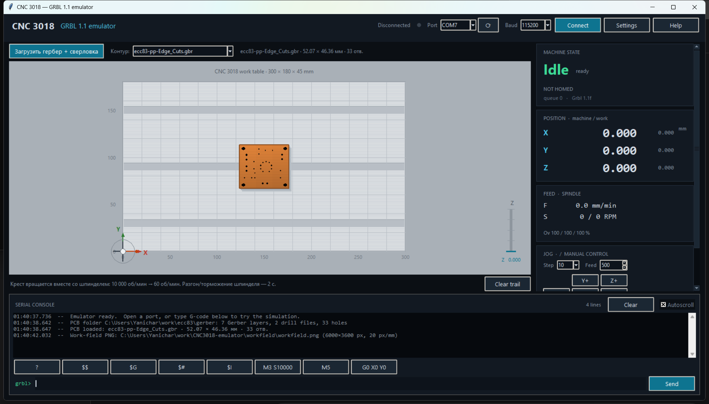

# CNC3018 GRBL 1.1 Emulator



Эмулятор контроллера **CNC3018** с прошивкой **Grbl 1.1**. Программа открывает
последовательный порт (по умолчанию **COM7**, 115200 8-N-1), отвечает как
настоящий станок и показывает в графическом интерфейсе состояние машины,
светлый алюминиевый рабочий стол и подвижную каретку в виде креста. Крест
вращается вместе со шпинделем: **10 000 об/мин → 60 об/мин**, разгон и
торможение шпинделя занимают **2 секунды**.

На стол можно загрузить настоящую плату из Gerber + сверловки: она рисуется в
масштабе 1:1 (контур `#C87533`, отверстия чёрные) и одновременно сохраняется в
PNG рабочего поля **6000 × 3600 px** (300 × 180 мм, 20 px/мм) — основу для
будущей «виртуальной камеры».

## Что умеет

- **Протокол Grbl 1.1**: баннер `Grbl 1.1f ['$' for help]`, ответы `ok` /
  `error:N`, push-сообщения `[MSG:...]`, `[GC:...]`, `[VER:...]`, `$N0=...`,
  статус-отчёты `<Idle|MPos:...|FS:...|...>`.
- **G-code**: `G0/G1/G2/G3` (дуги с IJK и R в плоскостях G17/G18/G19,
  гелисы), `G4`, `G10 L2/L20`, `G17/G18/G19`, `G20/G21`, `G28/G30` (+ `.1`),
  `G38.2`, `G43.1/G49`, `G53`, `G54–G59`, `G80`, `G90/G91`, `G92/G92.1`,
  `G93/G94`, `M0/M1/M2/M30`, `M3/M4/M5`, `M7/M8/M9`, `T`, `F`, `S`, `N`.
  Ошибки разбора соответствуют кодам Grbl (`error:1…38`).
- **Системные команды**: `$$`, `$#`, `$G`, `$I`, `$N`, `$x=val`,
  `$J=...` (jogging), `$H`, `$X`, `$C`, `$SLP`, `$RST=$|#|*`.
- **Real-time**: `Ctrl-X` (сброс), `?`, `!`, `~`, `0x84` (дверь), `0x85`
  (отмена jog), override-команды `0x90–0x9D`, `0x9E`, `0xA0/0xA1`.
- **Кинематика**: трапецеидальный профиль скорости с ограничениями
  `$110–$112` (макс. скорость) и `$120–$122` (ускорение), учёт хода по осям,
  склейка коллинеарных сегментов. Позиция, скорость и RPM считаются в
  реальном времени.
- **Шпиндель**: разгон/торможение 2 с (на полную шкалу `$30`), override
  оборотов, отображение фактических и заданных оборотов.
- **Аварии и состояния**: `Idle, Run, Hold, Jog, Alarm, Door, Check, Home,
  Sleep`; программный `M0`-пауз, feed hold/resume, soft limits (`ALARM:2`),
  сброс во время движения (`ALARM:3`), homing.
- **EEPROM**: настройки, смещения `G54–G59`, `G28/G30` и startup-строки
  сохраняются в JSON между запусками.
- **GUI**: состояние, DRO (машинные и рабочие координаты), светлый
  алюминиевый стол 300×180 мм с T-пазами, ось Z, след траектории, консоль с
  историей команд, кнопки jog и настройки `$$` с редактированием значений.
- **Плата на столе**: кнопка «Загрузить гербер + сверловка» открывает папку,
  читает все `*.drl` и показывает выпадающий список Gerber-слоёв для выбора
  контура платы. Контур заливается цветом `#C87533`, отверстия рисуются
  чёрными кругами реального диаметра, масштаб платы и отверстий — 1:1.
- **Изображение рабочего поля**: `workfield/workfield.png`, 6000 × 3600 px
  (20 px/мм) — готовый кадр для будущей «виртуальной камеры»; координаты
  станка ↔ пиксели задаются `FieldGeometry`.
- **Офлайн-режим**: без открытого порта команды из консоли выполняются
  внутренним движком — можно сразу посмотреть анимацию.

## Установка

Нужен Python 3.10+ (проверено на 3.13) и `pyserial`:

```powershell
python -m pip install -r requirements.txt
```

`tkinter` входит в стандартную сборку Python для Windows.

## Запуск

```powershell
# GUI, порт COM7 по умолчанию
python main.py

# то же через модуль
python -m grbl_emulator --port COM7 --baud 115200

# сразу подключиться к порту при старте GUI
python main.py --autoconnect

# только последовательный сервер, без GUI
python -m grbl_emulator --port COM7 --no-gui

# другие полезные опции
python -m grbl_emulator --help
```

Параметры:

| Опция | Значение по умолчанию | Описание |
|---|---|---|
| `--port` | `COM7` | порт, который открывает эмулятор |
| `--baud` | `115200` | скорость порта |
| `--no-gui` | выкл. | работать без графического интерфейса |
| `--eeprom PATH` | `%LOCALAPPDATA%\CNC3018-emulator\grbl-eeprom.json` | файл «EEPROM» |
| `--no-eeprom` | выкл. | не сохранять настройки на диск |
| `--spindle-ramp` | `2.0` | время разгона/торможения шпинделя, с |
| `--autoconnect` | выкл. | GUI сразу открывает порт |
| `--workfield PATH` | `<проект>\workfield\workfield.png` | куда сохранять PNG рабочего поля |

## Подключение Candle

Эмулятор и Candle должны смотреть в **разные концы одной виртуальной пары**
com0com. Типовая настройка:

1. Эмулятор: `python main.py` → порт **COM7** → кнопка **Connect**
   (или `python main.py --autoconnect`).
2. Candle: выбрать **COM8**, скорость **115200**, нажать Connect.
3. Candle при подключении отправляет `Ctrl-X`; эмулятор отвечает баннером
   `Grbl 1.1f ['$' for help]`, после чего GUI Candle получает настройки,
   координаты и статус-отчёты.

Порт можно сменить в выпадающем списке в шапке окна. Если эмулятор и Candle
запущены на одном и том же порту, открыть его дважды не получится — это
нормально, используйте второй конец пары.

## Интерфейс

- **Загрузить гербер + сверловка** — выбрать папку проекта. Из неё читаются все
  файлы сверловки (`*.drl`, `*.drd`, `*.xln`, `*.exc`) и список Gerber-слоёв;
  слой, задающий контур платы (обычно `*Edge_Cuts*`), выбирается в списке
  **Контур**. По умолчанию стол пустой.
- **Стол** — светлая алюминиевая плита `$130 × $131` мм с T-пазами, сеткой и
  линейкой. Плата лежит в центре поля.
- **Крест** — каретка в координатах X/Y; линия-след показывает траекторию.
- **Z-шкала** справа — текущая координата Z и ход `$132`.
- **MACHINE STATE** — состояние и подсказка (`reset required` для критических
  аварий, `$X to unlock` для остальных).
- **POSITION** — машинные координаты (крупно) и рабочие (мельче).
- **FEED / SPINDLE** — фактическая подача, фактические/заданные обороты и
  полоса разгона.
- **JOG** — шаг и подача, кнопки X/Y/Z, `XY 0`.
- **Reset / Unlock / Home / Hold / Resume** — реальные real-time команды.
- **SERIAL CONSOLE** — всё, что уходит в порт и приходит из него; можно вводить
  G-code, `$`-команды и нажимать быстрые кнопки. Работает и без порта.
- **Settings** — таблица `$$` с редактированием значений и сбросом `$RST=$`.

Горячие клавиши: `F5` — сброс (Ctrl-X), `Ctrl+L` — очистить консоль,
`↑`/`↓` — история команд.

## Плата и изображение рабочего поля

### Загрузка платы

1. Нажать **«Загрузить гербер + сверловка»** и выбрать папку с проектом
   (например, `C:\Users\Yanichar\work\ecc83\gerber`).
2. Эмулятор прочитает все файлы сверловки и заполнит список **Контур**
   Gerber-слоями папки. Слой с `Edge_Cuts` (или `outline`, `profile`) выбирается
   автоматически, любой другой можно выбрать вручную.
3. Контур заливается цветом **`#C87533`**, отверстия рисуются **чёрными**
   кругами диаметром сверла. Масштаб платы и отверстий — 1:1, без растяжения
   под размер стола; плата центрируется на поле 300 × 180 мм.

### PNG для «виртуальной камеры»

При загрузке платы (и при смене слоя) в фоне перерисовывается весь стол:

| Свойство | Значение |
|---|---|
| файл по умолчанию | `workfield/workfield.png` (каталог в `.gitignore`) |
| размер | **6000 × 3600 px** |
| масштаб | **20 px/мм** |
| поле | 300 × 180 мм (профиль CNC3018, `$130` × `$131`) |
| фон | светлый алюминий с поперечной шлифовкой |
| плата | `#C87533` с текстурой меди, мягким бликом, фаской по краю и тенью на столе; отверстия `#000000` |

Кадр готов для камеры: изображение не перерисовывается при движении, а
координаты станка и пиксели связаны через `grbl_emulator.workfield.FieldGeometry`:

```python
from grbl_emulator.workfield import FieldGeometry

geometry = FieldGeometry()              # 300 × 180 мм, 20 px/мм
px, py = geometry.to_pixel(x_mm, y_mm)  # px = x*20, py = (180 - y)*20
left, top, right, bottom = geometry.crop_box(x_mm, y_mm, w_mm, h_mm)
```

Поле 300 × 180 мм рассчитывается из масштаба 20 px/мм: 300·20 = 6000,
180·20 = 3600 px (в TASK-2 были указаны 3600 × 7600 px, но это не соответствует
рабочему полю станка). Пересчитать кадр без GUI можно так:

```powershell
python tools/render_workfield.py --gerber-dir C:\work\ecc83\gerber
# или с явным слоем и путём:
python tools/render_workfield.py --gerber-dir ... --layer ecc83-pp-Edge_Cuts.gbr --output workfield/workfield.png
```

### Что поддерживается из форматов

- **Gerber (RS-274X)**: `FS`/`MO` (мм и дюймы, LZ/TZ), апертуры `C/R/O`,
  `G01/G02/G03` (дуги с I/J), регионы `G36/G37`, `D01/D02/D03`; контур
  собирается из замкнутых цепочек линий и дуг.
- **Excellon**: `METRIC`/`INCH`, `T<n>C<диаметр>`, абсолютные координаты,
  десятичные и целочисленные координаты с форматом `3:3`/`LZ`/`TZ`; PTH/NPTH
  определяется по имени файла.
- Дорожки, маски и шелкография не рисуются — только контур и отверстия.

## Настройки по умолчанию (профиль CNC3018)

| Настройка | Значение | Настройка | Значение |
|---|---|---|---|
| `$0` шаг импульса | 10 мкс | `$22` homing | 0 |
| `$10` маска статуса | 1 (MPos) | `$24/$25` homing feed/seek | 25 / 500 |
| `$11` junction deviation | 0.010 мм | `$27` pull-off | 1 мм |
| `$12` допуск дуги | 0.002 мм | `$30` макс. шпиндель | 10 000 об/мин |
| `$13` дюймы | 0 | `$31` мин. шпиндель | 0 |
| `$20` soft limits | 0 | `$32` laser mode | 0 |
| `$21` hard limits | 0 | `$100–$102` шагов/мм | 800 |
| `$110–$112` макс. скорость | 800 мм/мин | `$120–$122` ускорение | 50 мм/с² |
| `$130–$132` ход | 300 / 180 / 45 мм | | |

Любое значение можно изменить через `$x=value`, кнопку **Settings** или
команду `$RST=$` (сброс к профилю CNC3018).

## Тестирование

```powershell
python -m pytest
```

94 теста: парсер (модальные состояния, дуги, коды ошибок), движок (статус,
движение, шпиндель, hold/resume, jog, homing, soft limits, check mode,
EEPROM), Gerber/Excellon (контур, дуги, сверловка, PTH/NPTH), рендер рабочего
поля и реальный обмен по паре COM7↔COM8.

Ручная проверка «глазами Candle» — отдельный пробник, который открывает второй
конец пары и выполняет рукопожатие, движение, разгон шпинделя, feed hold,
сброс и разблокировку:

```powershell
# терминал 1
python -m grbl_emulator --port COM7 --no-gui --no-eeprom

# терминал 2
python tools/grbl_probe.py --port COM8
```

Пример результата:

```
Probing COM8 @ 115200 8-N-1
  [PASS] soft reset -> Grbl banner
  [PASS] $I build info
  [PASS] $G modal state
  [PASS] $# parameters
  [PASS] ? status report
  [PASS] G0 X10 Y5
  [PASS] spindle ramp up ~50 % after 1 s
  [PASS] spindle reaches 10 000 RPM
  [PASS] spindle stops
  [PASS] feed hold (!)
  [PASS] cycle start (~) completes the move
  [PASS] reset during motion -> ALARM:3
  [PASS] $X unlock returns to Idle
RESULT: all checks passed
```

## Архитектура

| Файл | Назначение |
|---|---|
| `grbl_emulator/settings.py` | `$`-настройки, профиль CNC3018, валидация кодов ошибок, JSON-EEPROM |
| `grbl_emulator/gcode.py` | разбор G-code, модальные группы, дуги, смещения, коды `error:N` |
| `grbl_emulator/motion.py` | геометрия сегментов и дуг, профиль скорости, модель шпинделя |
| `grbl_emulator/engine.py` | состояние станка, очередь движений, `$`-команды, real-time, статус-отчёты |
| `grbl_emulator/transport.py` | поток pyserial: чтение байтов, real-time символы, запись ответов, снапшоты для GUI |
| `grbl_emulator/gui.py` | tkinter-интерфейс, анимация каретки и шпинделя, консоль, настройки |
| `grbl_emulator/pcb.py` | разбор Gerber (контур, дуги, регионы) и Excellon (сверловка), модель `Board` |
| `grbl_emulator/workfield.py` | рендер PNG 20 px/мм (алюминий, плата, отверстия), `FieldGeometry` для камеры |
| `grbl_emulator/main.py` | CLI и запуск GUI/headless |
| `tests/` | pytest: парсер, движок, Gerber/Excellon, PNG, реальный COM-порт |
| `tools/grbl_probe.py` | ручной end-to-end тест через второй конец пары |
| `tools/render_workfield.py` | пересчёт PNG рабочего поля без запуска GUI |

`Engine` не работает с портом напрямую: транспорт передаёт ему байты и
забирает готовые строки ответов. Такое разделение позволяет тестировать
протокол без железа и рисовать GUI из независимого снапшота.

## Ограничения и допущения

- Полноценный look-ahead планировщик Grbl не воспроизводится: каждый сегмент
  планируется трапецией, коллинеарные соседние сегменты склеиваются. Время
  обработки углов отличается от реального станка.
- Нет физических концевиков и щупа: hard limits (`$21`) не срабатывают,
  `G38.2` просто доезжает до цели и записывает `PRB` с признаком неудачи.
  Soft limits (`$20`) работают программно.
- Homing упрощён: оси едут в машинный ноль `(0, 0, 0)` со скоростью `$25`,
  без поиска концевиков. Рабочее поле — `0…$130/131/132`, а не отрицательные
  координаты, как у Grbl с концевиками на максимальном конце.
- Шпиндель: линейный разгон 2 с до `$30`, без инерции и нагрузки; крест
  вращается по фактическим оборотам.
- Строка ограничена 79 символами (`error:11`), RX-буфер — 128 байт, как в
  Grbl; контрольные суммы (`*NN`) и `%` не поддерживаются.
- `$11` (junction deviation) и `$12` (arc tolerance) можно задать и увидеть в
  `$$`, но планировщик использует собственные допуски.
- Из платы рисуются только контур и отверстия: медные слои, маски и
  шелкография не отображаются. Плата центрируется на столе 300 × 180 мм, а не
  ставится по абсолютным координатам Gerber-файла.
- PNG рабочего поля генерируется заново при каждой загрузке платы (≈2 с в
  фоновом потоке); при изменении `$130`/`$131` кадр остаётся 300 × 180 мм.

## Лицензия

Учебный/инженерный проект; используйте на свой риск. Эмулятор не управляет
реальным станком, но повторяет его протокол — не направляйте его вывод на
настоящий контроллер.
